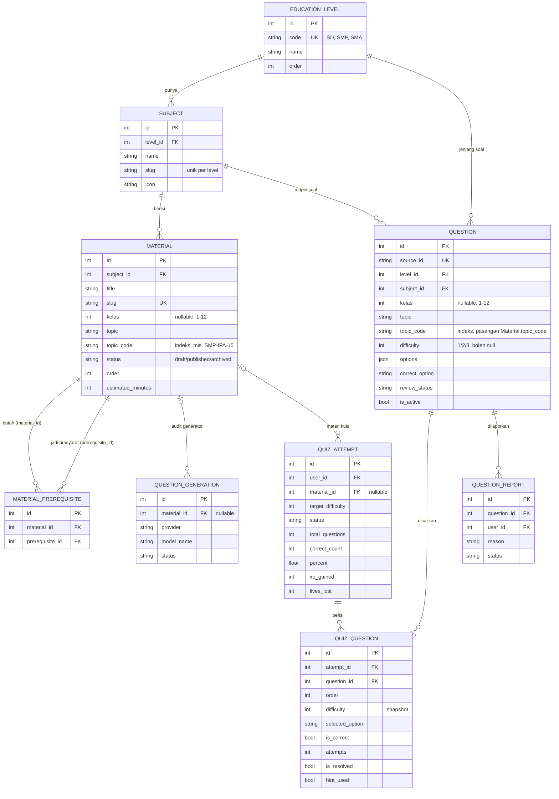
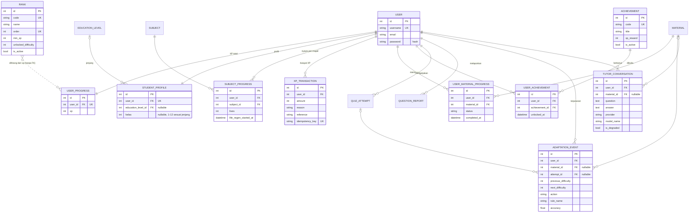

# EduQuest — ERD (Entity Relationship Diagram)

**Tanggal:** 2 November 2026
**Basis:** `backend/apps/*/models.py` pada commit `a1e4a65`
**Database:** SQLite (development), siap dipindah ke PostgreSQL

> Dokumen ini menggambarkan skema **apa adanya** sesuai model Django. Kalau model
> berubah, perbarui tabel dan diagram di sini pada commit yang sama.

---

## 1. Cara membaca

- **PK** = primary key, **FK** = foreign key, **UK** = unique constraint.
- Garis `||--o{` berarti relasi satu-ke-banyak yang punya kolom FK di sisi kanan.
- Garis `|o--o{` berarti relasi opsional (`null=True` atau `SET_NULL`).
- Garis `}o..o{` berarti relasi **logis** tanpa kolom FK (dihitung saat runtime).
- Semua tabel memakai nama `app_model` di database, mis. `learning_question`.

## 2. Peta domain

| Domain | App | Tabel |
|---|---|---|
| Akun | `accounts` | `StudentProfile` |
| Konten & kuis | `learning` | `EducationLevel`, `Subject`, `Material`, `MaterialPrerequisite`, `Question`, `QuestionReport`, `QuestionGeneration`, `QuizAttempt`, `QuizQuestion` |
| Gamifikasi & progres | `progress` | `Rank`, `UserProgress`, `SubjectProgress`, `XPTransaction`, `UserMaterialProgress`, `Achievement`, `UserAchievement`, `AdaptationEvent` |
| AI Tutor | `tutor` | `TutorConversation` |
| Autentikasi | `auth` (bawaan Django) | `User` |

Total: **19 tabel aplikasi + 1 tabel `auth_user`**.

---

## 3. Diagram A — Konten dan kuis



---

## 4. Diagram B — Pengguna, gamifikasi, progres, AI



---

## 5. Relasi dan aturan hapus

| # | Relasi | Kardinalitas | `on_delete` | Catatan |
|---|---|---|---|---|
| 1 | `EducationLevel` → `Subject` | 1 : N | CASCADE | Hapus jenjang menghapus mapelnya |
| 2 | `EducationLevel` → `Question` | 1 : N | PROTECT | Soal tidak boleh kehilangan jenjang |
| 3 | `EducationLevel` → `StudentProfile` | 1 : N | SET_NULL | Profil tetap ada walau jenjang dihapus |
| 4 | `Subject` → `Material` | 1 : N | PROTECT | Mapel tidak bisa dihapus jika masih punya materi |
| 5 | `Subject` → `Question` | 1 : N | PROTECT | Sama seperti materi |
| 6 | `Subject` → `SubjectProgress` | 1 : N | CASCADE | Nyawa per mapel |
| 7 | `Material` → `MaterialPrerequisite.material` | 1 : N | CASCADE | Sisi "materi yang butuh" |
| 8 | `Material` → `MaterialPrerequisite.prerequisite` | 1 : N | CASCADE | Sisi "materi prasyarat" |
| 9 | `Material` → `QuestionGeneration` | 1 : N (opsional) | SET_NULL | Audit generator tetap tersimpan |
| 10 | `Material` → `QuizAttempt` | 1 : N (opsional) | SET_NULL | Riwayat kuis tidak hilang saat materi dihapus |
| 11 | `Material` → `UserMaterialProgress` | 1 : N | CASCADE | |
| 12 | `Material` → `AdaptationEvent` | 1 : N (opsional) | SET_NULL | |
| 13 | `Material` → `TutorConversation` | 1 : N (opsional) | SET_NULL | |
| 14 | `Question` → `QuizQuestion` | 1 : N | PROTECT | Soal yang sudah pernah disajikan tidak bisa dihapus |
| 15 | `Question` → `QuestionReport` | 1 : N | CASCADE | Laporan ikut terhapus |
| 16 | `QuizAttempt` → `QuizQuestion` | 1 : N | CASCADE | |
| 17 | `QuizAttempt` → `AdaptationEvent` | 1 : N (opsional) | SET_NULL | |
| 18 | `User` → `UserProgress` | 1 : 1 | CASCADE | |
| 19 | `User` → `StudentProfile` | 1 : 1 | CASCADE | Dibuat otomatis lewat signal |
| 20 | `User` → `SubjectProgress` | 1 : N | CASCADE | Unik `(user, subject)` |
| 21 | `User` → `XPTransaction` | 1 : N | CASCADE | |
| 22 | `User` → `UserMaterialProgress` | 1 : N | CASCADE | Unik `(user, material)` |
| 23 | `User` → `UserAchievement` | 1 : N | CASCADE | Unik `(user, achievement)` |
| 24 | `User` → `QuestionReport` | 1 : N | CASCADE | |
| 25 | `User` → `QuizAttempt` | 1 : N | CASCADE | |
| 26 | `User` → `AdaptationEvent` | 1 : N | CASCADE | |
| 27 | `User` → `TutorConversation` | 1 : N | CASCADE | |
| 28 | `Achievement` → `UserAchievement` | 1 : N | CASCADE | |
| 29 | `Rank` → `UserProgress` | **logis** | — | Tidak ada kolom FK |

### Constraint unik

| Tabel | Constraint |
|---|---|
| `EducationLevel` | `code` unik |
| `Subject` | `(level, slug)` unik |
| `Material` | `slug` unik |
| `MaterialPrerequisite` | `(material, prerequisite)` unik |
| `Question` | `source_id` unik |
| `QuizQuestion` | `(attempt, question)` unik, `(attempt, order)` unik |
| `UserProgress` | `user` unik (OneToOne) |
| `StudentProfile` | `user` unik (OneToOne) |
| `SubjectProgress` | `(user, subject)` unik |
| `UserMaterialProgress` | `(user, material)` unik |
| `UserAchievement` | `(user, achievement)` unik |
| `XPTransaction` | `idempotency_key` unik |
| `Rank` | `code` unik, `order` unik |
| `Achievement` | `code` unik |

---

## 6. Catatan desain

### 6.1 `Rank` dihitung, bukan FK

`UserProgress` tidak menyimpan `rank_id`. Rank ditentukan saat runtime dari XP:

```python
# apps/progress/models.py
@property
def rank(self) -> Rank | None:
    return Rank.for_xp(self.xp)

# Rank.for_xp: rank aktif dengan min_xp terbesar yang <= xp
```

Tier yang berlaku saat ini:

| Rank | `order` | `min_xp` | `unlocked_difficulty` |
|---|---|---|---|
| Bronze | 1 | 0 | 1 |
| Silver | 2 | 100 | 2 |
| Gold | 3 | 300 | 3 |

Konsekuensinya: mengubah `min_xp` langsung mengubah rank semua pengguna tanpa
migrasi data. `unlocked_difficulty` dipakai sebagai gerbang `target_difficulty`
saat memulai kuis.

### 6.2 `topic_code` adalah penghubung lunak

`Material.topic_code` dan `Question.topic_code` bertipe `CharField` yang sama
(mis. `SMP-IPA-15`), **tanpa foreign key**. Ini disengaja:

- Materi dan soal berasal dari sumber berbeda (materi kurasi manual, soal dari
  bank IndoMMLU), jadi kode topik dijadikan kunci bersama.
- Seleksi soal memakai kode ini sebagai sinyal utama: kode sama → skor tinggi,
  kode berbeda → skor negatif, kode kosong → fallback kemiripan kata kunci.
- Karena bukan FK, tidak ada jaminan integritas di level database. Penjagaannya
  ada di command `backfill_topics` dan validasi di `quiz_service`.

### 6.3 Snapshot pada `QuizQuestion`

`QuizQuestion.difficulty` menyalin `Question.difficulty` saat kuis dibuat.
Tujuannya agar penilaian dan laporan historis tidak berubah kalau metadata soal
diedit setelahnya. `QuizQuestion` juga menyimpan `attempts`, `is_resolved`,
`selected_option`, `hint_used`, dan `hint_source`.

Alur baru: jawaban salah mengurangi 1 nyawa dan soal yang sama tetap tampil
sampai dijawab benar. Hint tidak diberikan saat masih ada nyawa. Hint dan
pembahasan baru muncul ketika nyawa habis atau semua soal selesai. Saat nyawa
habis, hint dibuat untuk setiap soal yang pernah dijawab salah (termasuk yang
akhirnya dijawab benar).

### 6.4 Nyawa per mata pelajaran

Nyawa **tidak** disimpan di `UserProgress`, melainkan di `SubjectProgress`
(unik per `user` + `subject`). Regenerasi: 1 nyawa per 1 jam
(`LIFE_REGEN_INTERVAL`), maksimum `MAX_LIVES = 3`. `life_regen_started_at`
adalah awal interval berikutnya dan tidak di-reset saat kehilangan nyawa lagi.

### 6.5 XP idempoten

Semua penambahan XP lewat `XPTransaction` dengan `idempotency_key` unik, mis.:

```
quiz:{attempt_id}:correct:{quiz_question_id}
quiz:{attempt_id}:material-complete
achievement:{user_id}:{achievement_id}
```

Unique constraint inilah yang mencegah XP dobel saat request diulang.

### 6.6 `kelas` sebagai filter konten

`StudentProfile.kelas`, `Material.kelas`, dan `Question.kelas` menyimpan angka
1-12. Rentang yang sah ditentukan jenjang:

| Jenjang | Kelas |
|---|---|
| SD | 1-6 |
| SMP | 7-9 |
| SMA/SMK | 10-12 |

Validasi ada di `apps/learning/constants.py` (`LEVEL_KELAS`, `is_valid_kelas`),
lalu dipakai oleh serializer profil/registrasi, model `Material`, command
`import_materials`, dan filter `GET /api/materials/?level=SMP&kelas=8`.
`kelas` sengaja bukan tabel/foreign key tersendiri agar import konten dan
filter dashboard tetap sederhana.

### 6.7 Achievement

Hanya tiga achievement aktif, masing-masing dengan `xp_reward`:

| `code` | Syarat | XP |
|---|---|---|
| `first-quiz` | menyelesaikan kuis pertama | 20 |
| `perfect-score` | satu kuis 100% benar | 50 |
| `material-explorer` | menyelesaikan 5 materi | 30 |

`UserAchievement` menyimpan kapan achievement terbuka; XP-nya masuk sebagai
`XPTransaction` dengan `reason = achievement`.

---

## 7. Contoh kueri yang sering dipakai

```python
# Rank dan progres seorang pengguna
progress = UserProgress.objects.select_related("user").get(user=user)
progress.rank.name            # "Silver"
progress.xp_to_next_rank      # sisa XP menuju Gold

# Soal untuk satu materi, diurutkan berdasarkan kecocokan topik
from apps.learning.services.quiz_service import _material_relevance
pool = Question.objects.filter(
    subject=material.subject,
    level=material.subject.level,
    is_active=True,
    review_status__in=ALLOWED_STATUS,
)
relevance = _material_relevance(pool, material)

# Riwayat kuis beserta soal yang disajikan
attempt = QuizAttempt.objects.prefetch_related("quiz_questions__question").get(pk=attempt_id)

# Achievement yang sudah dibuka
user.achievements.select_related("achievement").values_list("achievement__code", flat=True)
```

---

## 8. Catatan data (bukan masalah skema)

| Hal | Kondisi saat ini |
|---|---|
| Soal bertopik | 1.215 dari 7.023 soal punya `topic_code`; 5.808 masih kosong dan memakai fallback kata kunci |
| `Question.difficulty` NULL | 131 soal SD IPA belum punya tingkat kesulitan |
| Penjelasan jawaban | Sebagian besar `explanation` kosong |
| Bank soal | Belum ada Matematika dan Bahasa Inggris |
| Kunci jawaban | Belum diverifikasi manusia |

Menjalankan `backfill_topics` **tidak** mengubah skema, hanya mengisi data.

---

## 9. Regenerasi diagram

Diagram di dokumen ini ditulis manual. Kalau ingin versi otomatis dari model:

```bash
pip install django-extensions
# tambahkan "django_extensions" ke INSTALLED_APPS, lalu:
python manage.py graph_models accounts learning progress tutor \
    --group-models --output ../docs/erd_auto.png
```

Saat ini `django-extensions` belum terpasang, jadi diagram di atas adalah
sumber acuan utama. Setiap kali `models.py` berubah, perbarui:

1. Bagian 3 dan 4 (Mermaid).
2. Bagian 5 (tabel relasi dan `on_delete`).
3. Bagian 6 (catatan desain) jika aturan bisnisnya ikut berubah.
