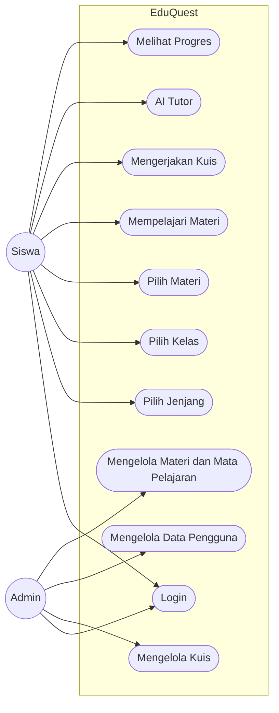

# Use Case EduQuest

Dokumen ini melengkapi `docs/Usecase.png`. Versi teks ini sudah memuat
**Pilih Kelas** yang menjadi tambahan alur siswa.

## Aktor

| Aktor | Peran |
|---|---|
| Siswa | Memilih jenjang/kelas, membaca materi, mengerjakan kuis, melihat progres, dan memakai AI Tutor |
| Admin | Mengelola soal, materi, mata pelajaran, dan data pengguna melalui Django Admin |

## Daftar use case

| Kode | Use case | Aktor | Ringkasan |
|---|---|---|---|
| UC-01 | Login | Siswa, Admin | Masuk dengan akun Django dan token API |
| UC-02 | Pilih Jenjang | Siswa | Memilih SD, SMP, atau SMA/SMK |
| UC-03 | Pilih Kelas | Siswa | Memilih kelas yang valid: SD 1-6, SMP 7-9, SMA/SMK 10-12 |
| UC-04 | Pilih Materi | Siswa | Melihat materi yang sudah difilter jenjang dan kelas |
| UC-05 | Mempelajari Materi | Siswa | Membaca materi, prasyarat, dan menandai selesai |
| UC-06 | Mengerjakan Kuis | Siswa | Menjawab soal sampai benar atau nyawa habis; hint/pembahasan muncul di akhir sesi |
| UC-07 | AI Tutor | Siswa | Bertanya tentang materi aktif dengan fallback non-AI |
| UC-08 | Melihat Progres | Siswa | Melihat XP, level, rank, achievement, dan nyawa per mapel |
| UC-09 | Mengelola Kuis | Admin | Meninjau/mengubah soal dan status publikasinya |
| UC-10 | Mengelola Data Pengguna | Admin | Melihat profil siswa, jenjang, dan kelas |
| UC-11 | Mengelola Materi dan Mata Pelajaran | Admin | Mengubah materi, kelas, mapel, dan prasyarat |

## Diagram

## Alur singkat siswa

1. Login.
2. Pilih jenjang.
3. Pilih kelas.
4. Pilih materi yang sesuai jenjang dan kelas.
5. Baca materi.
6. Kerjakan kuis: jawaban salah mengurangi nyawa dan soal tetap sama.
7. Sesi berakhir saat semua soal benar atau nyawa habis.
8. Lihat pembahasan, hint, XP, rank, dan progres.
9. Tanyakan bagian yang belum dipahami ke AI Tutor bila perlu.
